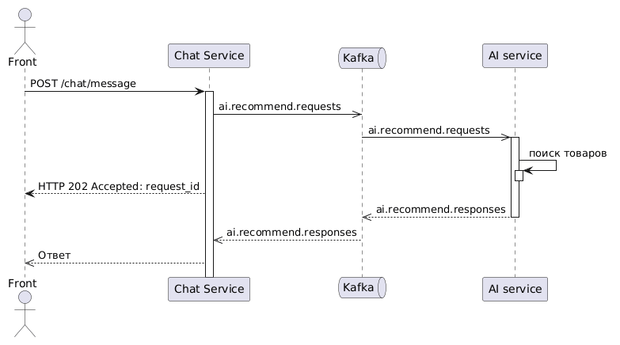

# AI-ассистент по подбору товаров маркетплейса

Проект проектирования асинхронного AI-чата: пользователь описывает потребность текстом («нужен набор для кемпинга на двоих»), ИИ подбирает товары из каталога маркетплейса.

> **Статус.** Пет-проект уровня проектирования: ТЗ, диаграммы, модель данных и SQL.

## Идея

Время работы ИИ нестабильно и может достигать десятков секунд, поэтому HTTP-запрос не должен ждать результата. Схема: Front получает `202 Accepted` сразу, запрос уходит в Kafka, результат возвращается клиенту по WebSocket.



## Ключевые проектные решения

| Задача | Решение |
|---|---|
| Долгий ответ ИИ | Асинхронная схема: 202 + Kafka + WebSocket |
| Повторная отправка клиентом | `request_id` генерирует клиент и служит ключом идемпотентности; повтор возвращает существующий запрос |
| Потеря сообщения при записи в БД и Kafka | Запрос сохраняется до публикации, флаг `published_at` фиксирует подтверждение брокера, воркер повторяет только неопубликованные |
| Зависшие запросы | Воркер таймаутов: `PENDING` старше 60 с переходит в `TIMEOUT` |
| Дубликаты сообщений | At-least-once доставка + идемпотентная обработка по `request_id`; поздние ответы игнорируются |
| Пропущенное WebSocket-событие | `GET /chat/requests/{id}`, клиент вызывает его после каждого переподключения |
| Доступ к чужим данным | `user_id` берётся только из JWT; чужие запросы недоступны |
| Хранение | 24 часа, затем очистка (позиции удаляются каскадом) |

## Артефакты проекта

Все документы лежат в репозитории и открываются прямо в браузере, скачивать ничего не нужно.

| Артефакт | Что внутри | Открыть |
|---|---|---|
| Техническое задание | REST API, WebSocket, Kafka-контракты, статусы, фоновые процессы, NFR | [docs/tz.md](docs/tz.md) |
| Словарь данных | Описание таблиц и полей, типы, примеры значений | [docs/data-dictionary.md](docs/data-dictionary.md) |
| ERD | Таблицы и связи | [ниже](#модель-данных) · [docs/erd.md](docs/erd.md) |
| SQL | Pапросы | [sql/](sql/) |

## Структура репозитория

```
docs/
  tz.md                 ТЗ: API, WebSocket, Kafka-контракты, статусы, NFR
  erd.md                ERD (Mermaid)
  data-dictionary.md    словарь данных
sql/
  02_queries.sql          запросы по уровням сложности
```

- **Основы:** `JOIN`, `GROUP BY`, `HAVING`, `LEFT JOIN ... IS NULL`.

## Ограничения и план развития

- Контекст диалога не передаётся ИИ: каждый запрос обрабатывается независимо. План: передавать в Kafka последние N запросов сессии.
- Восстановление чата после перезагрузки страницы опирается на `localStorage` клиента. План: `GET /sessions/{id}/requests`.
- Реализация сервисов не входит в текущую версию.